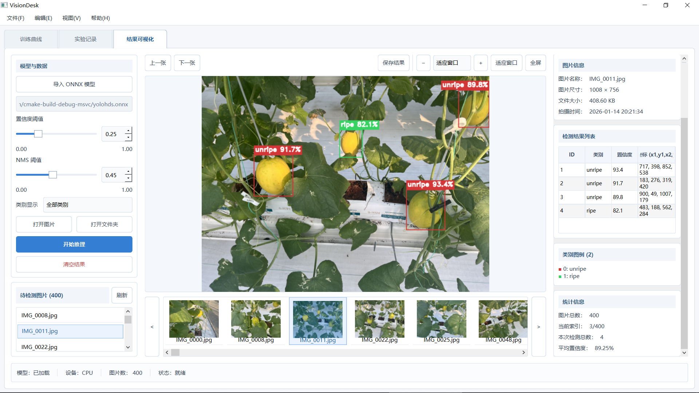

# VisionDesk

<p align="center">
  <strong>训练曲线分析 · 实验记录管理 · ONNX 检测结果可视化</strong>
</p>

<p align="center">
  
  
  
  
  <a href="./LICENSE"></a>
</p>
**VisionDesk** 是一款基于 Qt 6 和 C++17 的视觉实验桌面工具，将训练日志分析、实验归档与模型检测结果查看整合在同一个工作区中。主要面向使用 Ultralytics YOLO 训练日志和兼容 ONNX 检测模型的实验场景：对比训练曲线、整理消融实验指标、查看模型检测效果，以及导出图表和结果图片。

## 界面预览

### 训练曲线

同时查看多组实验的指标曲线，调整图表样式，并结合原始数据表分析训练过程。

<p align="center">
  
</p>

### 实验记录

使用 SQLite 保存实验指标、模型复杂度与备注，支持搜索、排序和表格导出。

<p align="center">
  
</p>

### 结果可视化

加载 ONNX 检测模型，浏览图片与缩略图，查看检测框、类别、置信度和推理耗时。

<p align="center">
  
</p>

> 前两张截图来自项目更名前的版本，窗口标题仍显示 DeepVision Workbench。

## 功能

### CSV 训练日志分析

- 打开单个 CSV 文件，或从文件夹导入多组训练日志。
- 通过文件树选择指标，在同一图表中对比 Loss、Precision、Recall、mAP 等曲线。
- 查看原始数据表与曲线的最大值、最小值、最终值。
- 调整曲线名称、颜色、透明度、线宽、线型、散点样式和图层顺序。
- 设置图例位置、背景网格、字体、坐标轴标题与导出比例。
- 支持图表缩放、拖动，以及文件树、数据表和属性面板的显示切换。
- 导出 PNG、JPEG 图片或 PDF 矢量图。

### SQLite 实验记录

- 将当前选中的 CSV 实验导入实验库，记录路径、最佳轮次与核心指标。
- 保存 Precision、Recall、mAP50、mAP50-95、参数量、GFLOPs 和备注。
- 按实验名称、CSV 路径和备注搜索，按名称、指标或更新时间排序。
- 在右侧详情中编辑名称、参数量、GFLOPs 和备注，提交后可逐次撤销修改。
- 删除实验记录，或将当前表格导出为 `.xlsx`。
- 对 CSV 路径执行唯一性约束，避免重复导入同一路径。

### ONNX 检测与结果查看

- 导入兼容的 ONNX 检测模型，从模型 `names` 元数据读取类别名称。
- 打开单张图片，或载入文件夹内的 JPG、JPEG、PNG、BMP 图片。
- 使用图片列表、缩略图和上一张／下一张按钮切换图片。
- 调整置信度和 NMS 阈值，对当前选中的图片执行 CPU 推理。
- 绘制检测框、类别标签和置信度，并按类别选择显示结果。
- 查看检测坐标、目标数量、平均置信度、推理耗时和图片信息。
- 支持缩放、适应窗口、全屏查看，将当前结果图片保存为 PNG 或 JPEG。

## 快速使用

1. **分析训练日志**：在“训练曲线”页打开 CSV 或文件夹，展开文件节点，勾选需要对比的指标。
2. **归档实验**：先在训练曲线的文件树中选中目标 CSV，再进入“实验记录”，点击“导入当前实验”，补充名称、参数量、GFLOPs 和备注。
3. **查看检测效果**：在“结果可视化”页导入 ONNX 模型，打开图片或文件夹，选中图片并设置阈值，点击“开始推理”。
4. **导出结果**：训练曲线使用“导出论文插图”，实验表使用“导出记录”，检测图片使用“保存结果”。

使用已部署的 Windows 版本时无需安装 Python 或配置训练环境；模型、CSV 和测试图片由用户自行准备。

### 数据保存

程序启动时，如果**当前工作目录**没有 `.db` 或 `.db3` 文件，会新建 `experiments.db`；如果存在数据库文件，则弹出选择窗口。当前工作目录取决于程序的启动方式，不一定等于 EXE 所在目录。

实验数据库保存的是实验指标和 CSV 路径，不会将 CSV 内容、模型和原始图片复制进数据库。移动或备份实验时，请同时保留所需的源文件。

撤销历史保存在当前会话的内存中，按最近一次成功提交的顺序撤销，可跨记录执行；重启后不会保留，也不用于恢复已删除的记录。

## 输入格式与支持范围

### CSV 日志

主要面向 Ultralytics YOLO 风格的 `results.csv`。导入实验库时，日志需要包含可识别的 Precision、Recall、mAP50 和 mAP50-95 列；任意结构的 CSV 并不保证兼容。日志本身应有完整表头、数据行和一致的列数。

### ONNX 模型

当前检测后处理适用于下列布局：

| 项目 | 当前支持范围 |
|---|---|
| 推理设备 | CPU |
| 输入 | 单个图像输入，Float32、NCHW，形状为 `[1, 3, H, W]` |
| 输入尺寸 | 静态输入沿用模型尺寸；动态高宽使用 `640 × 640` |
| 检测输出 | Float32，`[1, 4+C, N]` 或 `[1, N, 4+C]`，其中 `C` 为类别数 |
| 类别信息 | ONNX 的 `names` 元数据，类别 ID 从 0 连续编号 |
| 图片格式 | JPG、JPEG、PNG、BMP |

请使用带有有效类别元数据、输出布局匹配的 YOLO 检测模型。当前界面没有提供外部类别标签文件的导入入口。带独立 objectness 通道、已内置 NMS 的输出，以及分割、姿态等模型输出，需要另外适配。

文件夹导入用于浏览和逐张检测当前目录内的图片，不会递归扫描子目录，也不会自动对整个文件夹执行批量推理。当前未提供视频推理、GPU 设备切换或检测结果表格的批量导出。

## 技术栈与项目结构

| 模块 | 使用技术 |
|---|---|
| 桌面界面 | Qt 6 Widgets、Qt Designer、QSS |
| 曲线绘制 | QCustomPlot |
| 实验数据 | Qt SQL、SQLite |
| Excel 导出 | QXlsx |
| 模型推理 | ONNX Runtime |
| 图像预处理与绘制 | OpenCV |
| 编译构建 | C++17、CMake 3.16+ |

```text
VisionDesk/
├── src/
│   ├── database/                  # 数据库连接、建表与记录操作
│   ├── include/QXlsx/             # 随仓库提供的 Excel 库
│   ├── resource/                  # 图标、样式与 Qt 资源
│   ├── utils/
│   │   ├── loadONNX.cpp/.h        # 模型元数据、预处理、推理与后处理
│   │   └── qcustomplot.cpp/.h     # 曲线绘制库
│   └── widget/                    # 主窗口、三个功能页面与导入对话框
├── tests/database/                # 数据库与提交／撤销回归测试
├── CMakeLists.txt
├── main.cpp
├── runtime1.png                   # 训练曲线截图
├── runtime2.png                   # 实验记录截图
├── runtime3.png                   # 结果可视化截图
├── LICENSE
└── README.md
```

## 从源码构建

### 环境准备

下面以 **Windows x64 + MSVC + Qt 6** 为例。需要安装：

- 支持 C++17 的 MSVC 工具链，以及对应的 Windows SDK。
- Qt 6 的 MSVC 64 位组件，包含 Core、Gui、Widgets、PrintSupport 和 Sql。
- CMake 3.16 或更高版本。
- 与工具链兼容的 OpenCV Windows x64 SDK。
- ONNX Runtime Windows x64 SDK，包含头文件、导入库和 `onnxruntime.dll`。

QCustomPlot 和 QXlsx 已包含在仓库中。Qt、OpenCV 和 ONNX Runtime 的架构与编译器 ABI 应保持兼容；使用官方 MSVC 版依赖时，请选择 MSVC 工具链。

### 获取源码

```powershell
git clone https://github.com/GRZ21/VisionDesk.git
cd VisionDesk
```

### 命令行构建

在 Visual Studio 的 **Developer PowerShell（x64 环境）** 中执行。以下路径为示例，请替换为本机 SDK 的实际位置：

```powershell
cmake -S . -B build-release -G "NMake Makefiles" `
  -DCMAKE_BUILD_TYPE=Release `
  -DCMAKE_PREFIX_PATH="D:/Qt/6.8.2/msvc2022_64" `
  -DOpenCV_DIR="D:/opencv/build/x64/vc16/lib" `
  -DONNXRUNTIME_ROOT="D:/onnxruntime"

cmake --build build-release --target VisionDesk
```

`OpenCV_DIR` 应指向包含 `OpenCVConfig.cmake` 的目录。`ONNXRUNTIME_ROOT` 应指向 SDK 根目录，通常包含 `include/` 和 `lib/`。

构建成功后生成 `build-release/VisionDesk.exe`。CMake 会将 ONNX Runtime 和所链接的 OpenCV 共享库复制到程序目录；Qt 运行依赖还需按下节部署。Release 配置不显示控制台，Debug 配置保留控制台用于调试。

### CLion / Qt Creator

打开根目录 `CMakeLists.txt`，选择与依赖匹配的 MSVC 工具链，在 CMake 配置中填写 `CMAKE_PREFIX_PATH`、`OpenCV_DIR` 和 `ONNXRUNTIME_ROOT`，选择 Release 后构建 `VisionDesk` 目标即可。IDE 的构建目录可以与上述命令行示例不同。

## Windows 部署

### 目录版

先完成 Release 构建，再从项目根目录执行：

```powershell
New-Item -ItemType Directory -Force dist/VisionDesk
Copy-Item build-release/VisionDesk.exe dist/VisionDesk/
Copy-Item build-release/*.dll dist/VisionDesk/
Copy-Item LICENSE dist/VisionDesk/

& "D:/Qt/6.8.2/msvc2022_64/bin/windeployqt.exe" `
  --release --compiler-runtime `
  "dist/VisionDesk/VisionDesk.exe"
```

请使用与构建时相同的 Qt 安装中的 `windeployqt`。它负责收集 Qt 运行库和插件，OpenCV 与 ONNX Runtime 的 DLL 也必须保留。部署目录至少应包含：

```text
dist/VisionDesk/
├── VisionDesk.exe
├── Qt6Core.dll
├── Qt6Gui.dll
├── Qt6Widgets.dll
├── Qt6Sql.dll
├── onnxruntime.dll
├── opencv_*.dll
├── platforms/qwindows.dll
├── sqldrivers/qsqlite.dll
├── imageformats/
├── iconengines/
└── …其余运行库与插件
```

OpenCV DLL 的具体名称取决于版本和构建方式。分发时应保留完整部署目录，并在未安装开发环境的 Windows 机器上验证程序启动、数据库读写、图片保存和模型推理。

## 回归测试

数据库测试独立于主程序配置，覆盖数据库初始化、插入与约束检查，以及实验提交、连续撤销、写入失败和删除历史清理等行为。

在已配置 MSVC 的 Developer PowerShell 中执行：

```powershell
cmake -S tests/database -B build-tests -G "NMake Makefiles" `
  -DCMAKE_BUILD_TYPE=Release `
  -DCMAKE_PREFIX_PATH="D:/Qt/6.8.2/msvc2022_64"

cmake --build build-tests
$env:PATH = "D:/Qt/6.8.2/msvc2022_64/bin;" + $env:PATH
ctest --test-dir build-tests --output-on-failure
```

测试使用临时数据库，不会打开或修改用户的实验数据库。

## 反馈与许可

欢迎通过仓库 Issues 反馈问题。涉及兼容性时，请附上程序版本、复现步骤，以及 CSV 表头或 ONNX 输入/输出形状等必要信息。

项目自身代码采用 [MIT License](./LICENSE)。QCustomPlot、QXlsx、Qt、OpenCV 和 ONNX Runtime 等第三方组件遵循各自的许可证。
